<picture>
  <source media="(max-width: 600px) and (prefers-color-scheme: dark)" srcset="assets/ana-narrow-dark.svg">
  <source media="(max-width: 600px)" srcset="assets/ana-narrow-light.svg">
  <source media="(prefers-color-scheme: dark)" srcset="assets/ana-dark.svg">
  
</picture>

[Read the docs](https://matiomacedo.github.io/ana/) · [Download a release](https://github.com/matiomacedo/ana/releases) · [Report an issue](https://github.com/matiomacedo/ana/issues)

I'm Mátio. I build AI tools for developers and students, and ana is the main one: a coding agent that understands your project, plans before it edits, checks its own work and remembers what it learned.

### Other tools

- [**Inkstrip**](https://github.com/matiomacedo/Inkstrip) converts PDF and DOCX files to Markdown, with AI-written descriptions for the images.
- [**Noctary**](https://github.com/matiomacedo/Noctary) lets you ask questions, get summaries and take quizzes over your own study notes.
- [**pocket-voice**](https://github.com/matiomacedo/pocket-voice) is a Claude Code plugin that reads responses aloud.

Reach me on [LinkedIn](https://www.linkedin.com/in/m%C3%A1tio-macedo-753309400/).
